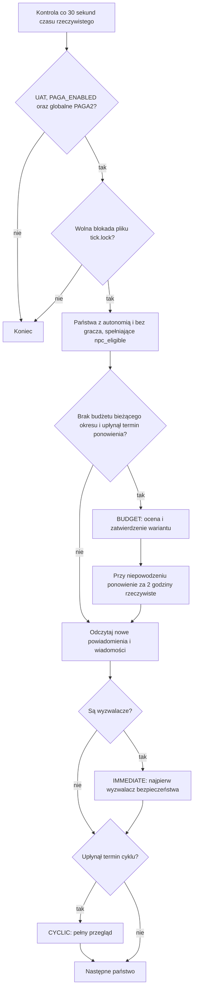
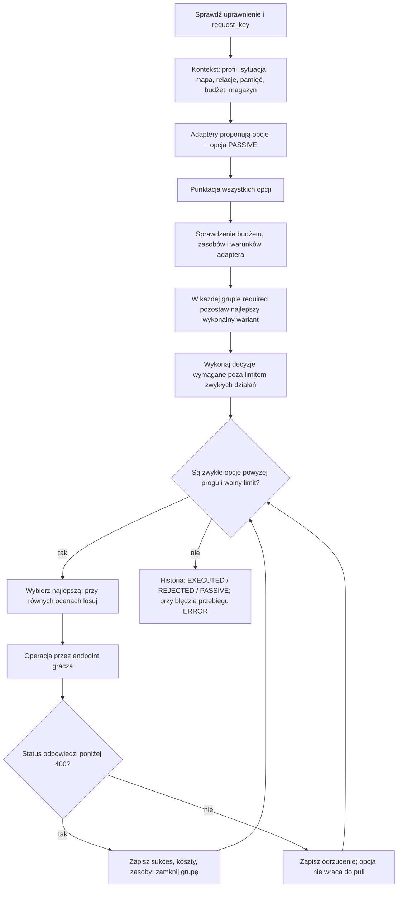
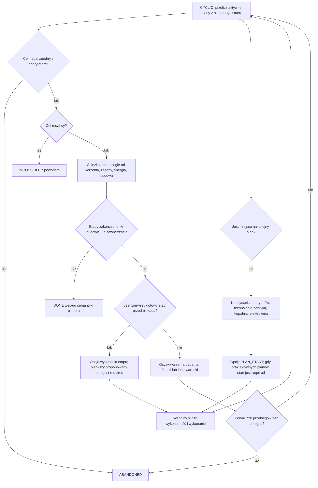
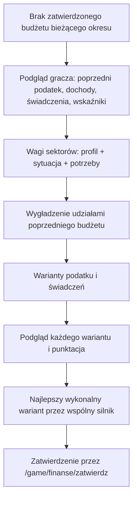

# PAGA2 — schematy działania

Analiza kodu ZEUS GAME UAT z 13 listopada 2026, punkt odniesienia: `1b8dc4e`. Opis implementacji, a nie odczyt bieżącej konfiguracji lub stanu państw w bazie. Schematy Mermaid można wyświetlić w podglądzie Markdown; wersja HTML obok zawiera schematy bez zewnętrznych bibliotek.

## 1. Harmonogram i trzy tryby

Kolejność w obrębie jednego państwa: **budżet → reakcja doraźna → cykl**. „Natychmiastowa” reakcja oznacza obsługę przy sprawdzeniu harmonogramu; nie jest synchroniczną reakcją w chwili ataku. Przegląd cykliczny domyślnie przypada co 60 minut rzeczywistych (`interval_minutes`, konfigurowalne), a pierwszy termin ma stałe przesunięcie zależne od ID państwa. Zegar gry jest osobny: wpływa m.in. na okres budżetu i ukończenie badań.

Silnik ponownie sprawdza globalne włączenie, profil, autonomię, `npc_eligible` i utratę suwerenności. Powtórzony `request_key` zwraca istniejącą decyzję. Błąd jednego państwa nie zatrzymuje kolejnych.

Źródła: `engine/paga2_scheduler.py`, `game/paga2/engine.py`, `game/paga2/triggers.py`, `game/paga2/models.py`.

## 2. Wybór i wykonanie decyzji

**Próg zwykłego działania:** ocena musi być **ściśle większa** od `max(50, ocena PASSIVE)`. PASSIVE = `50 + 5 + (cierpliwość − 50)/10`, pomniejszone o 6 podczas wojny lub 3 przy zagrożeniu. W trybie BUDGET próg wynosi minus nieskończoność.

**Limit prób zwykłych działań:** CYCLIC = `1 + floor(ambicja/40)` (1–3), IMMEDIATE = 2 podczas wojny, poza nią 1; BUDGET = 1. Nieudana próba zużywa iterację limitu. Odpowiedzi na propozycje, rozstrzygnięcia okupacyjne i wybrane etapy rozwoju oznaczone `required` są obsługiwane osobno, niezależnie od progu oraz limitu. W grupie required silnik sortuje po punktach; nie używa randomizera remisów.

Sukces jednej opcji blokuje pozostałe opcje w tej samej grupie. Wynik całego przebiegu to EXECUTED, jeśli choć jedna próba się powiodła, nawet gdy inne się nie udały. PASSIVE oznacza brak prób. Zapis obejmuje alternatywy, składniki ocen, blokady, wejścia i wyniki operacji.

Źródła: `game/paga2/engine.py`, `game/paga2/scoring.py`, `game/paga2/randomizer.py`, `game/paga2/gateway.py`.

## 3. Punktacja i ograniczenia

`ocena = 50 + priorytety + cechy + charakter + relacje + rozwaga finansowa + ryzyko + bonus adaptera + nieprzewidywalność`

| Składnik | Implementacja |
|---|---|
| Priorytety | Suma `40 × waga priorytetu × wpływ opcji × mnożnik sytuacji`; kolejność priorytetów ma znaczenie. |
| Cechy | Odchylenie cech 0–100 od neutralnych 50, powinowactwa adaptera; wynik ograniczony do −20…20. |
| Charakter państwa | Dopasowanie kategorii, ograniczone do −16…16. |
| Relacje | Sojusze, historyczne związki, patron/satelita, zaufanie, zagrożenie i pamięć ataków. |
| Rozwaga | Kara kwadratowa względem udziału kosztu w limicie jednej akcji, maksymalnie −40. |
| Ryzyko | `−ryzyko × 20 × (100 − tolerancja strat)/100`. |
| Bonus adaptera | Ocena specyficzna dla domeny, np. niedobór energii albo potrzeba obrony. |
| Nieprzewidywalność | Rozrzut do ±4, tłumiony przewidywalnością; deterministyczny dla pary request_key/opcja. |
| Remis | Oddzielne losowanie SystemRandom między opcjami oddalonymi od najlepszej o **mniej niż 2 pkt**; zapis w tabeli losowań. |

Sytuacja: **wojna**, gdy istnieje wojna kinetyczna lub obca okupacja własnych regionów; **zagrożenie**, gdy są niedawne wrogie działania, zapamiętane zagrożenie ≥60 albo wrogi sąsiad; w pozostałych przypadkach **pokój**. Np. wojna mnoży wagę obrony przez 2,5, ofensywy przez 1,8, środowiska przez 0,35.

Limit jednej akcji = `0,6 − 0,4 × konserwatyzm_fiskalny/100` (20–60% początkowo dostępnych środków sektora). Limit przebiegu = `min(0,9; 1,6 × limit_akcji)` (32–90%). Wymagany jest też zapas surowców, a pojedyncze zużycie co do zasady nie przekracza limitu akcji względem dostępnego zapasu. Specjalny najmniejszy zakup punktu badań (`minimal_purchase`) omija limity rozwagi, ale nadal wymaga pieniędzy.

Źródła: `game/paga2/scoring.py`, `game/paga2/catalog.py`, `game/paga2/situation.py`.

## 4. Planowanie rozwoju

Punkty badań można kupować częściowo. Rozpoczęty rozwój technologii blokuje ponowną inwestycję do ukończenia. Surowiec z własnego złoża prowadzi do kopalni; brak złoża może prowadzić do zewnętrznego etapu zakupu w handlu. Nie każdy etap zasobowy blokuje zakończenie planu. Status `DONE` może oznaczać zakończenie decyzji inwestycyjnych przy trwającej budowie, nie gotowy obiekt produkcyjny. Plany wojskowe obsługuje osobno moduł wojny.

Źródła: `game/paga2/planner.py`, `game/paga2/holdings.py`, `game/paga2/location.py`, `game/paga2/war.py`.

## 5. Budżet

Od **1 października 3001 czasu Entendy** okresy są kwartalne. Starsze komentarze PAGA2 mówią jeszcze o półroczu, ale harmonogram korzysta z aktualnego `period_key()` finansów. Potrzeby zwiększają wagę badań przy oczekujących etapach planów; wykorzystanie poprzedniego sektora modyfikuje wagę od ×0,55 do ×1,45; wystarczająca liczba baz lub nadmiar sprzętu poza wojną zmniejsza wagę wojska przez ×0,6. To korekta wag, nie bezwzględny zakaz inwestowania w obronę.

Źródła: `game/paga2/budget.py`, `game/finance_service.py`, `engine/paga2_scheduler.py`.

## 6. Domena działań i rola modeli językowych

| Adapter | Tryby | Zakres |
|---|---|---|
| budget | BUDGET | Podatek, podział środków, świadczenia. |
| planner | CYCLIC | Plany rozwoju i kolejne etapy. |
| industry | CYCLIC | Naprawy, rozbudowa, wznowienie lub likwidacja obiektów. |
| trade | CYCLIC | Oferty, zakupy i obsługa braków. |
| finance | CYCLIC, IMMEDIATE | Przesunięcia środków, wnioski pożyczkowe, spłaty. |
| defense | CYCLIC, IMMEDIATE | Bazy, wyposażenie, obrona przeciwrakietowa, radary, szkolenie. |
| diplomacy | CYCLIC, IMMEDIATE | Relacje, propozycje, odpowiedzi, sojusze, pokój. |
| intelligence | CYCLIC, IMMEDIATE | Wywiad, kontrwywiad i działania hybrydowe. |
| war | CYCLIC, IMMEDIATE | Uderzenia konwencjonalne, najazdy, okupacje, odbijanie; wypowiadanie wojny tylko w IMMEDIATE. |
| communication | CYCLIC, IMMEDIATE | Wybór okazji do wystąpienia i zlecenie wypowiedzi AI. |
| bases_abroad | CYCLIC, IMMEDIATE | Zezwolenia i bazy zagraniczne. |

PAGA2 czyta ekrany przez `view.py` i wykonuje operacje przez `gateway.py` w tożsamości państwa. Endpointy stosują reguły gracza. Planer i historia mają też własne zapisy w bazie; nie wszystko w systemie jest wywołaniem HTTP.

Modele językowe dostają profil, sytuację, plany, ostatnie działania i stosunek do rozmówcy (`llm_context.py`). Algorytm wybiera inicjowanie komunikacji, model generuje jej treść. **Wyjątek istotny dla interpretacji:** `finance.py` wprost pozostawia decyzję o udzieleniu pożyczki modelowi AI, udostępniając ocenę zdolności finansowej. Nie należy więc opisywać całego systemu jako pozbawionego decyzji AI.

## 7. Ograniczenia widoczne w kodzie — do osobnego rozważenia

Poniższe obserwacje nie zostały zmienione w ramach korekt wyglądu:

1. Wykonalność opcji sprawdzana jest przed pętlą działań. Po sukcesie aktualizowane są liczniki wydatków i zasobów, ale pozostałe opcje nie przechodzą ponownie `check_resources` ani `adapter.check`. Reguły endpointu mogą odrzucić późniejszą operację, natomiast wewnętrzny limit rozwagi całego przebiegu nie jest ponownie weryfikowany.
2. `minimal_purchase` zwraca sukces sprawdzenia zaraz po kontroli pieniędzy. Pomija także dalszą pętlę sprawdzenia surowców; obecne zastosowanie dotyczy zakupu punktów rozwoju, ale rozszerzanie tego znacznika wymaga ostrożności.
3. Kursory wiadomości/powiadomień oraz kolejny termin cyklu zapisywane są przed wykonaniem silnika. Błąd nie oznacza automatycznego ponowienia tych samych wyzwalaczy. Dla nieudanego budżetu istnieje osobna ścieżka ponowienia.
4. Unikalność request_key chroni zapis historii, a wywołania endpointów i zapis historii nie są jedną wspólną transakcją. Idempotencja operacji domenowych jest osobną warstwą; sam dziennik nie stanowi gwarancji dokładnie jednokrotnego wykonania w razie awarii procesu.
5. Próg 720 oznacza porzucenie dopiero przy `idle_cycles > 720`. Wiele komentarzy ma historyczne nazwy okresów; właściwe zachowanie należy odczytywać z wywoływanych funkcji finansowych.

To analiza statyczna bieżącego kodu; nie potwierdza, jakie państwa i ustawienia są aktualnie włączone na działającym UAT.
